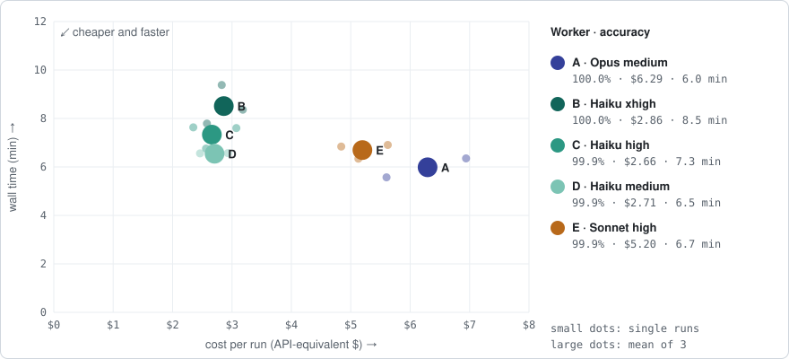
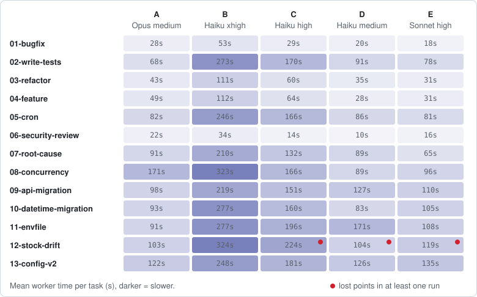
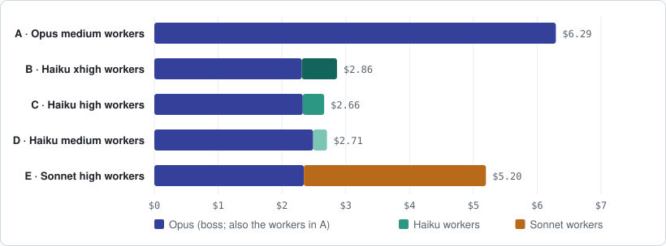
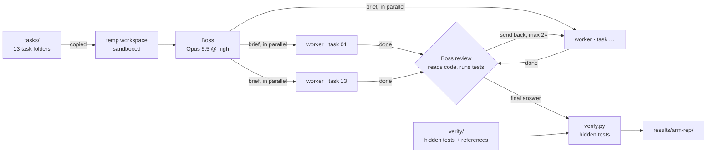

# Opus brain, fast hands?

A small, reproducible benchmark for a popular claim about AI coding agents:

> Use your strongest model (**Opus 5.5**) as the brain: it plans, briefs and reviews.
> Hand the actual coding to a cheaper, faster model (**Haiku 5.5**).
> You get **the same quality, faster and cheaper**.

We gave the same 13 Python coding tasks to five setups. The boss was always Opus 5.5 @ high;
only the worker model and its reasoning effort changed. Each setup ran 3 times, and hidden
tests graded every result.

Full tables, including min–max ranges and per-task numbers, are in [`results/REPORT.md`](results/REPORT.md).

## Results

| Worker (boss: Opus @ high) | Accuracy | Wall time | Cost per run | vs all-Opus | Send-backs per run | Output tokens |
|---|---|---|---|---|---|---|
| **A** · Opus 5.5 @ medium (baseline) | **100.0%** | **6.0 min** | $6.29 | – | 0.7 | 154k |
| **B** · Haiku 5.5 @ xhigh | **100.0%** | 8.5 min | $2.86 | time +42%, cost −55% | 0.3 | 687k |
| **C** · Haiku 5.5 @ high | 99.9% | 7.3 min | **$2.66** | time +23%, cost −58% | 1.0 | 441k |
| **D** · Haiku 5.5 @ medium | 99.9% | 6.5 min | $2.71 | time +9%, cost −57% | 2.3 | 294k |
| **E** · Sonnet 5.5 @ high | 99.9% | 6.7 min | $5.20 | time +12%, cost −17% | 2.0 | 196k |

Mean over 3 runs per setup, all 13 tasks. Cost is the CLI's API-equivalent price.



**Verdict:** the claim holds on quality and cost, but not on speed. Haiku workers matched
Opus's accuracy at less than half the price, and were 9–42% slower.

### What we learned

1. **Quality is a wash on these tasks.** Every setup scored at least 99.9%. The only misses
   were single hidden tests on `12-stock-drift`, one run each for Haiku high, Haiku medium and
   Sonnet high. The Opus boss reviews every result and sends bad work back, so worker mistakes
   rarely reach the final score. They show up as send-backs instead.
2. **Haiku workers cut the bill by 55–58%.** All-Opus costs $6.29 per batch; Opus + Haiku costs
   $2.66–2.86.
3. **Opus is still fastest, and Haiku medium comes close.** More effort doesn't help Haiku here.
   xhigh wrote 2.3× the output tokens of medium and took 8.5 min instead of 6.5 min. The extra
   time goes into thinking, not into running tests.

   

4. **Once the workers are cheap, the boss is the bill.** With Haiku workers, Opus accounts for
   $2.3–2.5 of every run, over 80%. Further savings have to come from the boss.

   

5. **Sonnet doesn't pay off for this job.** It was as fast as Haiku medium but only 17% cheaper
   than Opus, and it missed the same hidden test.

**Recommendation:** for an Opus-plans, cheap-model-codes setup, use **Haiku @ medium**. It costs
less than half as much as all-Opus, is nearly as fast, and the Opus review keeps quality level.
If speed matters more than cost, stay with all-Opus.

## How the benchmark works



1. **Copy.** `run.sh` copies `tasks/` to a fresh temp folder outside the repo. Agents never see
   `verify/`.
2. **Brief.** The boss (Opus 5.5 @ high) reads each task's `TASK.md`, writes a brief, and spawns one
   `worker` subagent per task. All workers run in parallel.
3. **Work.** Each worker, the model under test, edits the code and runs the visible tests.
4. **Review.** The boss reads the changes, reruns the tests, and may send a task back up to twice.
   It never writes code itself.
5. **Score.** `verify.py` grades the final workspace with hidden tests, seeded bugs and randomized
   comparisons against reference solutions.

### The setups (arms)

| Arm | Boss | Worker |
|---|---|---|
| **A** (baseline) | Opus 5.5 @ high | Opus 5.5 @ medium |
| **B** (the original claim) | Opus 5.5 @ high | Haiku 5.5 @ xhigh |
| **C** | Opus 5.5 @ high | Haiku 5.5 @ high |
| **D** | Opus 5.5 @ high | Haiku 5.5 @ medium |
| **E** | Opus 5.5 @ high | Sonnet 5.5 @ high |

### Keeping it fair

- **Same instructions.** Every arm gets word-for-word the same boss prompt (`spec/SPEC.md`) and
  worker prompt (`spec/worker.md`). Only the worker's model and effort differ (`config.env`).
- **Blind boss.** The boss is never told which model its workers are, so it plans and reviews the
  same way in every arm.
- **Same conditions.** Runs are started in parallel groups, so changes in API load affect the arms
  alike. Each run has its own workspace and output folder.
- **Honest timing.** Wall time runs from start to the boss's final answer. Workers run in parallel,
  so it's roughly the slowest task plus the boss's planning and review.
- **Fair scoring.** `python3 verify.py --self-test` checks that every reference solution scores 100%
  and every untouched starter scores below 100%. Every hidden expectation follows from `TASK.md` or
  the existing code.

**Judging a claim.** The claim is *supported* for an arm if its accuracy is within 2 points of A's
*and* it is faster or cheaper. It is *refuted* if the arm loses accuracy, or if it is neither faster
nor cheaper, for example because the boss keeps sending work back.

### The tasks

Thirteen Python tasks (stdlib only), from routine chores to bugs that need real thinking. Most
contain a trap that a quick, shallow fix falls into.

| Task | What the worker does | Kind | How it is scored |
|---|---|---|---|
| `01-bugfix` | Fix 3 bugs from vague user reports | routine | 13 hidden tests |
| `02-write-tests` | Write unit tests for a pricing module | routine | Share of 8 seeded bugs the tests catch |
| `03-refactor` | Rename a function across 4 files, add type hints and docstrings | routine | Hidden tests + checks for leftovers, hints, docstrings |
| `04-feature` | Implement a TTL + LRU cache from a written spec | medium | 14 hidden tests + 500 random operation sequences vs a reference |
| `05-cron` | Next run time of a cron expression (leap days, day-of-week rules, …) | hard | 19 hidden tests + 2,000 random expressions vs a reference |
| `06-security-review` | Find the vulnerabilities in a request-handler module | medium | 5 planted bugs found, minus points for false alarms |
| `07-root-cause` | Two billing complaints; find the root causes in a 9-module codebase | hard | 17 hidden tests; patching only the symptoms fails most |
| `08-concurrency` | A job queue runs jobs twice under load; make it thread-safe | hard | 6 hidden stress tests, including a deadlock trap |
| `09-api-migration` | Move 26 call sites from a deprecated HTTP helper to a new client | routine | 41 hidden tests on paths, params, timeouts, errors |
| `10-datetime-migration` | Replace `datetime.utcnow()` across an auth service, keeping every stored format | routine | 21 hidden tests |
| `11-envfile` | Rewrite a naive `.env` parser to a precise spec (quoting, escapes, `${VAR:-default}`, error lines) | hard | 38 hidden tests |
| `12-stock-drift` | Stock reservations drift; restore a cross-module invariant in 6 modules | hard | 22 hidden tests, incl. random operation sequences |
| `13-config-v2` | Migrate a settings file to format v2 with a compatibility contract; update every caller | hard | 26 hidden tests |

Some starters earn partial credit because hidden tests also cover behaviour that already worked.
The report shows this as the "do-nothing score".

## Running it

Needs the [Claude Code](https://code.claude.com) CLI (logged in, with access to Opus, Sonnet and
Haiku 5.5) and Python 3.10+. On macOS the sandbox works out of the box; on Linux it needs
`bubblewrap` and `socat`.

```bash
python3 verify.py --self-test                    # free: checks the scoring
./run.sh a smoke '01-*'                          # ~$0.30: checks your setup end to end

# One wave = one run of each arm, started together. Repeat for reps 1–3.
for rep in 1 2 3; do
  for arm in a b c d e; do ./run.sh $arm $rep > results/$arm-$rep.log 2>&1 & done; wait
done

python3 report.py > results/REPORT.md            # markdown tables
python3 visualize.py                             # charts: docs/*.svg
```

A full run of all 13 tasks takes 5–15 minutes and costs $2.50–7 API-equivalent. On a
subscription it comes out of your usage limits. `MAX_BUDGET_USD` in `config.env` caps each run.
Models, effort levels and allowed shell commands are all set in `config.env`.

Each run writes `results/<arm>-<rep>/`:

| File | What it holds | Committed? |
|---|---|---|
| `scores.json` | Score per task, with what failed | ✅ |
| `meta.json` | Arm, models, effort, wall time | ✅ |
| `claude.json` | Raw CLI output: cost, tokens, blocked commands | ❌ local paths |
| `transcript/` | Boss and worker session transcripts | ❌ large, local paths |
| `workspace/` | The final code the agents produced | ❌ large |

`report.py` and `visualize.py` need the raw files, so they only regenerate on the machine that ran
the benchmark. The committed `results/REPORT.md` and `docs/*.svg` charts are the published record.

## Repository layout

```
config.env            models, effort, budget, allowed tools per arm
run.sh                runs one arm once: ./run.sh <a|b|c|d|e> <rep> [task-glob]
spec/                 boss prompt (SPEC.md) and worker prompt (worker.md)
tasks/                the 13 task folders agents work on
verify/               hidden tests and reference solutions (never shown to agents)
verify.py             scoring, plus --self-test
report.py             results/ → markdown report
visualize.py          results/ → SVG charts in docs/
results/              per-run scores + meta, REPORT.md
docs/                 charts embedded in this README
```

## Caveats

- **Ceiling effect.** The Opus review catches most worker mistakes, so final accuracy can't separate
the setups well. Send-backs are the better signal of raw worker quality. Tasks that also fool the
reviewer would be needed to find where cheap workers break down.
- **Scope.** These are small, self-contained Python tasks. Results describe them, not every codebase.
- **The hidden tests are public in this repo**, so future models may have seen them. Write fresh
tasks before trusting new results.